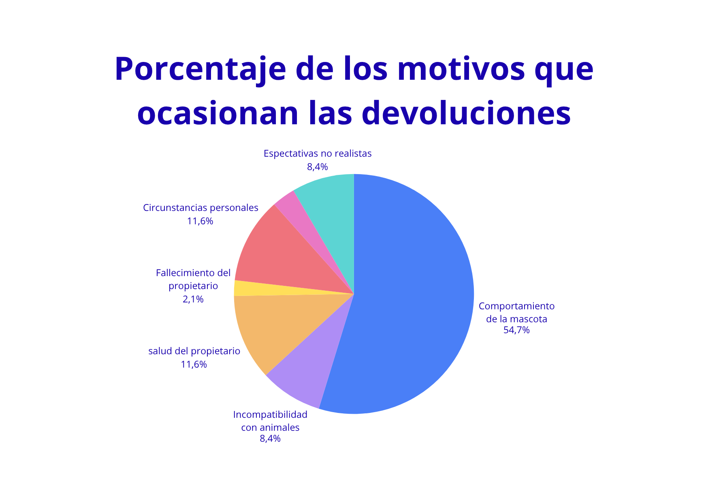
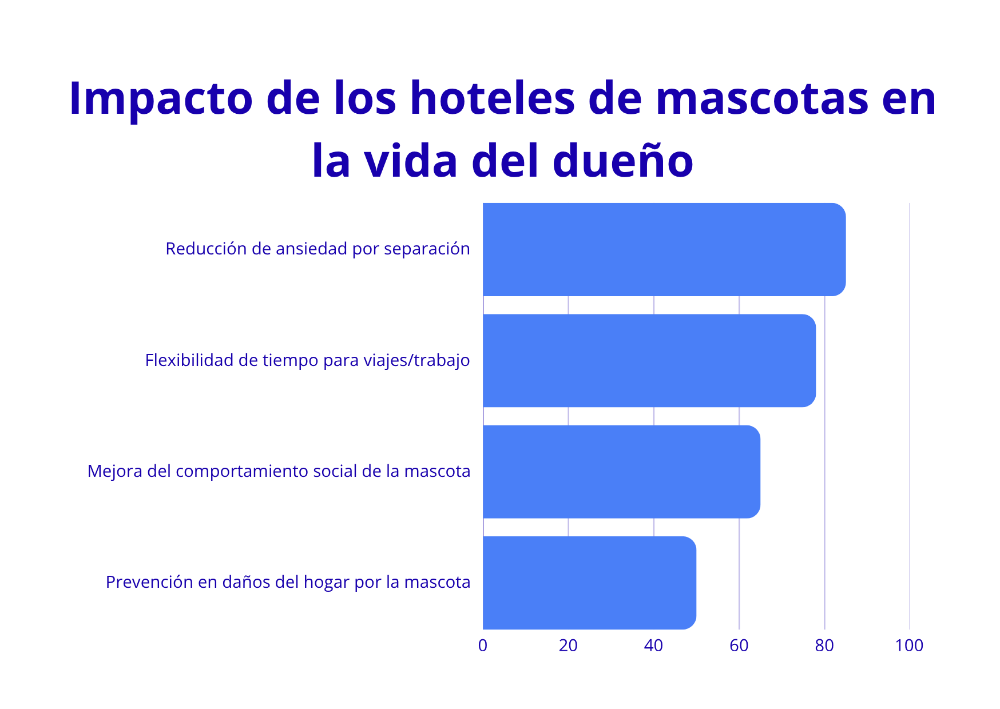
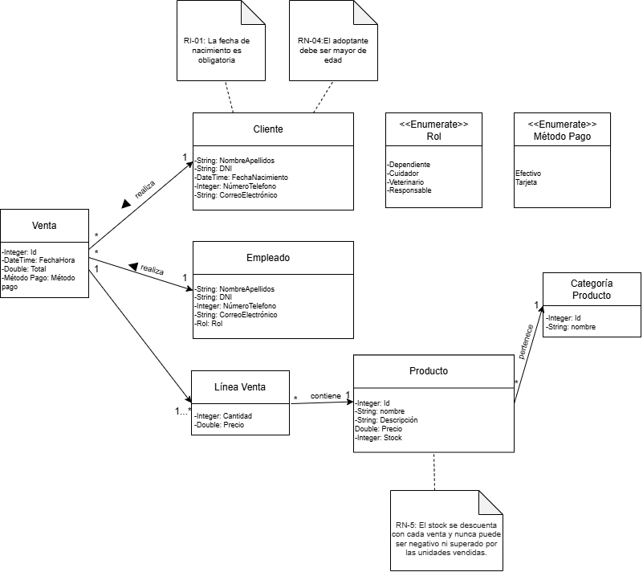
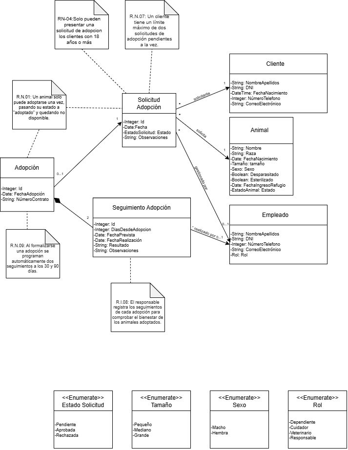
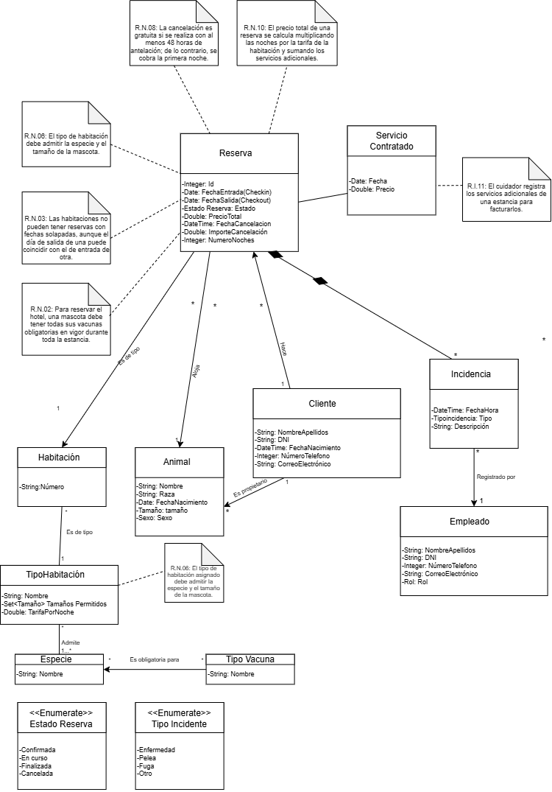
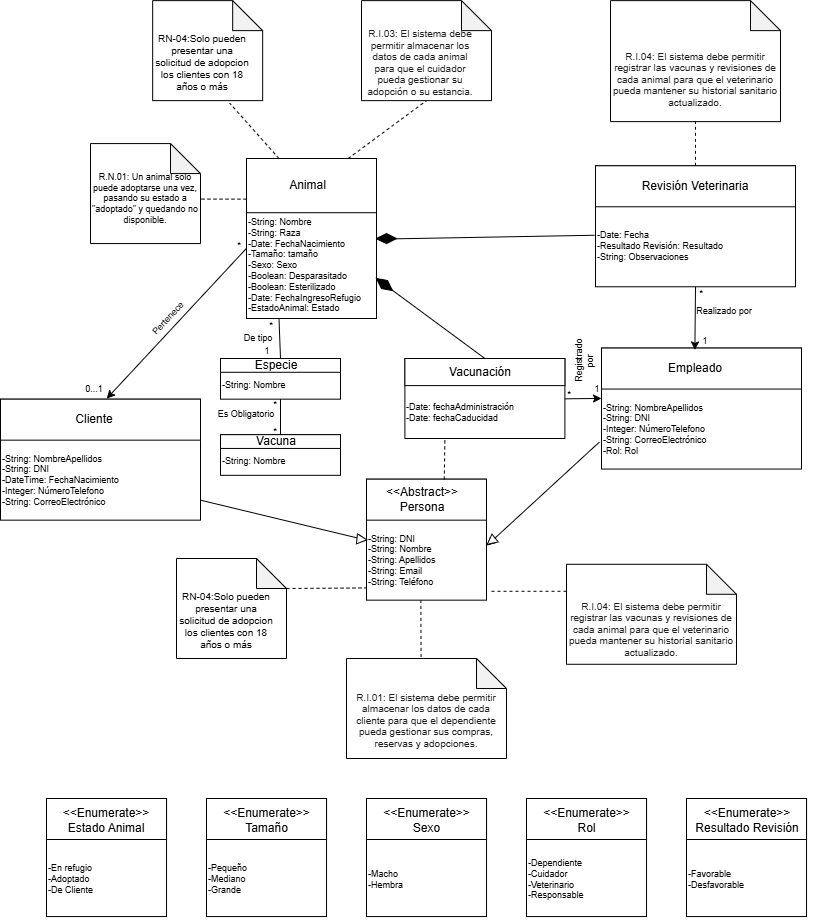

# ***My Little Pets Shop***: gestión de tienda de animales, adopciones y hotel para mascotas

**Miembros del grupo L5-03** 

> 1. Martín Arcos, María Dolores  
> 2. Muñoz Domínguez, Cayetana  
> 3. López Requena, Mar  
> 4. Gómez Rodríguez, Begoña

> 

## **1\. Introducción al problema**

**My Little pets shop** es un negocio local de una ciudad mediana que reúne tres actividades en un mismo espacio:

> 1. **Tienda:** venta de alimentación, accesorios, juguetes, higiene y productos de salud para animales de compañía.  
> 2. **Refugio y adopciones:** acoge animales procedentes de rescate o abandono y gestiona su adopción responsable.  
> 3. **Hotel para mascotas:** alojamiento temporal de perros, gatos y pequeños animales mientras sus dueños están ausentes por cualquier circunstancia (viajes, trabajo…).

### **Gráficos justificantes**
Como se observa en las gráficas adjuntas sobre el impacto de los hoteles de mascotas, la separación temporal y la gestión de alojamientos generan un reto emocional y operativo muy importante. Por este motivo hemos elegido este proyecto: para dar solución a la fragmentación de datos actual mediante un sistema centralizado que automatice las reservas, el control sanitario y las adopciones, garantizando el bienestar de los animales y la eficiencia del negocio.

### **Clientes y usuarios**

> * **Clientes:** personas con mascotas que compran productos o reservan el hotel.  
> * **Adoptantes:** personas que quieren incorporar un animal a su hogar.  
> * **Personal:** dependientes de tienda, cuidadores (hotel y refugio), veterinarios colaboradores, equipo de limpieza y personal responsable del negocio.

### 

### **Situación actual**

Actualmente la gestión se realiza con hojas de cálculo sueltas, una agenda en papel para las reservas del hotel y carpetas con las fichas de los animales. No existe un registro único de clientes: los datos de quien compra, quien reserva y quien adopta se anotan por separado.

### 

### **Problemas detectados**

> * **Reservas:** se producen solapamientos y sobreocupación porque la agenda no avisa de habitaciones ya ocupadas.  
> * **Sanidad:** se han alojado animales con vacunas caducadas, o sin ellas, y no hay aviso previo de las próximas caducidades.  
> * **Adopciones:** las fichas se pierden o quedan incompletas, y una vez entregado el animal no se hace seguimiento sistemático de su bienestar.  
> * **Tienda:** el stock se cuenta a mano, con roturas de stock frecuentes y sin histórico de ventas.  
> * **Precios:** las tarifas del hotel y los precios cambian y no queda constancia de lo cobrado en cada momento.  
> * 

### **Expectativas**

Un sistema de información que centralice clientes, animales, productos, ventas, adopciones y reservas, que haga cumplir automáticamente las normas del negocio (vacunas, capacidad, edad del adoptante, stock…) y que permita consultar de forma rápida la información necesaria para el trabajo diario.

### **Procesos principales**

flowchart LR  
    A\[Cliente\] \--\> B \[Compra de productos\]  
    A \--\> C \[Reserva de hotel\]  
    A \--\> D \[Solicitud de adopción\]  
    C \--\> E \[Check-in\] \--\> F \[Estancia y servicios\] \--\> G \[Check-out y pago\]  
    D \--\> H \[Entrevista y aprobación\] \--\> I \[Formalización\] \--\> J \[Seguimientos\]

### 

### 

## 

## 

## 

## **2\. Glosario de términos**

| Término | Definición |
| :---: | :---: |
|  **Adopción** | Proceso por el que un animal del refugio pasa a ser propiedad de una persona, tras una solicitud aprobada y un contrato firmado. |
| **Adoptante** | Cliente mayor de edad que solicita o completa la adopción de un animal. |
|  **Animal del refugio** | Animal propiedad de My Little pets shop, procedente de rescate o abandono, que está en el centro para ser adoptado. |
|  **Categoría de producto** | Agrupación de productos de la tienda (alimentación, accesorios, higiene, juguetes, salud). |
| **Cancelación** | Anulación de una reserva por parte del cliente antes de la entrada. |
| **Cartilla de vacunación** | Registro de las vacunas que se han administrado a un animal. |
| **Check-in** | Momento en que la mascota llega al hotel y se inicia la estancia. |
| **Check-out** | Momento en que el cliente recoge a su mascota y finaliza la estancia. |
| **Chip (microchip)** | Dispositivo de identificación implantado al animal, con un número único. |
| **Cliente** | Persona registrada en el sistema que compra, reserva o adopta. |
| **Contrato de adopción** | Documento firmado en el que el adoptante acepta las condiciones de cuidado del animal. |
| **Cuidador** | Empleado del hotel encargado de atender a las mascotas alojadas. |
| **Desparasitación** | Tratamiento veterinario contra parásitos internos y externos. |
| **Entrevista de adopción** | Reunión previa en la que el personal valora si el solicitante es adecuado para el animal. |
| **Especie** | Tipo de animal: perro, gato, conejo, ave, roedor, etc. |
| **Esterilización** | Intervención veterinaria que impide la reproducción del animal. |
| **Estancia** | Periodo real en el que una mascota  permanece en el hotel. |
| **Habitación** | Espacio del hotel asignable a una mascota, de un tipo determinado. |
| **Hotel** | Servicio de alojamiento temporal de mascotas de clientes. |
| **Incidencia**  | Suceso relevante ocurrido durante una estancia (enfermedad, pelea, fuga, etc.). |
| **Línea de venta** | Cada producto, con su cantidad y precio, dentro de una venta. |
| **Mascota de cliente** | Animal que pertenece a un cliente y que puede alojarse en el hotel. |
| **Noche** | Unidad de cobro del hotel; se cuenta una por cada día entre la entrada y la salida. |
| **Producto** | Artículo a la venta en la tienda, con precio y stock. |
| **Refugio** | Zona de My Little pets shop donde viven los animales en adopción. |
|  **Reserva** | Petición confirmada de una habitación para una mascota entre una fecha de entrada y una de salida. |
| **Revisión veterinaria** | Examen de un animal por el veterinario, con su resultado y observaciones. |
| **Seguimiento** | Contacto posterior a una adopción para comprobar el bienestar del animal. |
| **Servicio adicional** | Prestación opcional durante la estancia: paseo, baño, medicación, cepillado, etc. |
| **Solicitud de adopción** | Petición de un cliente para adoptar un animal concreto, que debe ser aprobada. |
| **Stock** | Número de unidades disponibles de un producto. |
| **Tarifa** | Precio por noche de un tipo de habitación. |
| **Tipo de habitación** | Clasificación de las habitaciones según la especie y tamaño del animal que admiten. |
| **Vacuna obligatoria** | Vacuna exigida para alojar a un animal en el hotel, según su especie. |
| **Venta** | Operación en la que un cliente adquiere uno o varios productos y paga por ellos. |

## 

## 

## 

## 

## **3\. Visión general del sistema**

### **3.1. Requisitos generales**

> * **RG-01.** El sistema gestionará el catálogo de productos y su stock.  
> * **RG-02.** El sistema registrará las ventas de la tienda y conservará su histórico.  
> * **RG-03.** El sistema gestionará los animales del refugio, su información sanitaria y todo el proceso de adopción hasta el seguimiento posterior.  
> * **RG-04.** El sistema gestionará las mascotas de los clientes, las habitaciones del hotel, las tarifas, las reservas y las estancias.  
> * **RG-05.** El sistema mantendrá un registro único de clientes y de personal.  
> * **RG-06.** El sistema impedirá operaciones que incumplan las normas del negocio: sobreocupación, vacunas caducadas, stock negativo, adopciones no permitidas, etc.  
> * **RG-07.** El sistema permitirá consultas rápidas para el trabajo diario (disponibilidad, entradas y salidas del día, stock bajo, seguimientos pendientes).  
> * **RG-08.** El sistema funcionará sobre un servidor de bases de datos MariaDB.

### 

### **3.2. Usuarios del sistema**

| Usuario | Descripción | Qué hace en el sistema |
| :---: | :---: | :---: |
|  **Cliente** |  Persona registrada con mascotas propias. | Consulta productos, disponibilidad y tarifas del hotel; ve sus mascotas y reservas. |
|  **Adoptante** |  Cliente que desea adoptar. | Consulta animales del refugio y sus fichas; sigue el estado de sus solicitudes. |
| **Dependiente** | Empleado de la tienda. | Consulta catálogo y stock; revisa ventas. |
|  **Cuidador** |  Empleado del hotel. | Consulta entradas, salidas, ocupación, servicios e incidencias. |
| **Veterinario** | Profesional sanitario colaborador. | Consulta y revisa historiales sanitarios y vacunas. |
|  **Responsable (administrador)** |  Gestiona el negocio. | Consulta solicitudes de adopción, seguimientos, ocupación y ventas globales. |

## 

## 

## 

## **4\. Catálogo de requisitos**

### **4.1. Requisitos funcionales**

#### **Tienda**

##### **R.F.01. Listar el catálogo de productos**

> * **Como:** cliente  
> * **Quiero:** ver el catálogo de productos filtrando por categoría  
> * **Para:** encontrar lo que necesito para mi mascota  

##### **R.F.02. Consultar el detalle de un producto**

> * **Como:** cliente  
> * **Quiero:** consultar la descripción completa de un producto  
> * **Para:** decidir si es adecuado para mi mascota  

##### **R.F.03. Listar productos con bajo stock**

> * **Como:** dependiente  
> * **Quiero:** ver los productos por debajo de un umbral de stock  
> * **Para:** reponerlos a tiempo  

##### **R.F.04. Consultar el historial de ventas de un cliente**

> * **Como:** cliente  
> * **Quiero:** ver mis compras anteriores  
> * **Para:** repetir pedidos y llevar un control de mis gastos  

##### **R.F.05. Listar las ventas de un periodo**

> * **Como:** responsable  
> * **Quiero:** ver las ventas realizadas entre dos fechas  
> * **Para:** analizar la facturación del negocio  

#### **Adopciones**

##### **R.F.06. Listar los animales en adopción**

> * **Como:** adoptante  
> * **Quiero:** ver los animales disponibles filtrando por especie, edad o tamaño  
> * **Para:** elegir con cuál contactar  

##### **R.F.07. Consultar el historial sanitario de un animal**

> * **Como:** veterinario  
> * **Quiero:** ver las vacunas y revisiones de un animal  
> * **Para:** valorar su estado de salud  

##### **R.F.08. Listar las solicitudes de adopción por estado**

> * **Como:** responsable  
> * **Quiero:** ver las solicitudes de adopción filtradas por estado  
> * **Para:** gestionar las pendientes  

##### **R.F.09. Consultar los seguimientos de adopción pendientes**

> * **Como:** responsable  
> * **Quiero:** ver los seguimientos que toca realizar  
> * **Para:** comprobar el bienestar de los animales adoptados  

#### **Hotel**

##### **R.F.10. Consultar la disponibilidad del hotel**

> * **Como:** cliente  
> * **Quiero:** ver las habitaciones libres entre dos fechas para mi mascota  
> * **Para:** saber si puedo reservar  

##### **R.F.11. Consultar las tarifas del hotel**

> * **Como:** cliente  
> * **Quiero:** ver el precio por noche de cada tipo de habitación y de los servicios adicionales  
> * **Para:** calcular el coste de la estancia

##### **R.F.12. Listar las reservas de un cliente**

> * **Como:** cliente  
> * **Quiero:** ver mis reservas pasadas y futuras  
> * **Para:** llevar control de las estancias de mis mascotas  

##### **R.F.13. Listar las entradas y salidas del día**

> * **Como:** cuidador  
> * **Quiero:** ver las mascotas que entran y salen hoy  
> * **Para:** preparar las habitaciones y atender a los clientes  

##### **R.F.14. Consultar la ocupación del hotel**

> * **Como:** responsable  
> * **Quiero:** ver el porcentaje de ocupación del hotel por día en un rango de fechas  
> * **Para:** planificar el personal y las tarifas  

##### **R.F.15. Consultar los servicios adicionales de una estancia**

> * **Como:** cuidador  
> * **Quiero:** ver los servicios contratados para una estancia  
> * **Para:** realizarlos y que se facturen correctamente  

##### **R.F.16. Listar las incidencias de una estancia**

> * **Como:** cliente  
> * **Quiero:** ver las incidencias ocurridas durante la estancia de mi mascota  
> * **Para:** estar informado de lo que ha sucedido  

#### **Clientes y mascotas**

##### **R.F.17. Listar las mascotas de un cliente**

> * **Como:** cliente  
> * **Quiero:** ver las mascotas que tengo registradas  
> * **Para:** elegir cuál reservar en el hotel  

##### **R.F.18. Listar las vacunas próximas a caducar**

> * **Como:** veterinario  
> * **Quiero:** ver las vacunas que caducan en los próximos 30 días  
> * **Para:** avisar a los clientes antes de su reserva  

### **4.1.1. Requisitos de información**

##### **R.I.01. Información de clientes**

> * **Como:** dependiente  
> * **Quiero:** almacenar los datos de cada cliente  
> * **Para:** gestionar sus compras, reservas y adopciones  
> * **Prueba de aceptación:**  
  * La fecha de nacimiento es obligatoria (necesaria para **R.N.04**).

##### **R.I.02. Información del personal**

> * **Como:** responsable  
> * **Quiero:** almacenar los datos de los empleados y su rol  
> * **Para:** saber quién realiza cada gestión

##### **R.I.03. Información de animales**

> * **Como:** cuidador  
> * **Quiero:** almacenar los datos de cada animal  
> * **Para:** gestionar su adopción o su estancia  

##### **R.I.04. Información sanitaria**

> * **Como:** veterinario  
> * **Quiero:** registrar vacunas y revisiones de cada animal  
> * **Para:** mantener su historial sanitario  

##### **R.I.05. Información de productos**

> * **Como:** dependiente  
> * **Quiero:** almacenar los datos de los productos y sus categorías  
> * **Para:** gestionar el catálogo  

##### **R.I.06. Información de ventas**

> * **Como:** dependiente  
> * **Quiero:** almacenar cada venta con sus líneas  
> * **Para:** conservar el histórico de compras  

##### **R.I.07. Información de solicitudes de adopción y adopciones**

> * **Como:** responsable  
> * **Quiero:** almacenar solicitudes y adopciones formalizadas  
> * **Para:** controlar el proceso de adopción  

##### **R.I.08. Información de seguimientos**

> * **Como:** responsable  
> * **Quiero:** registrar los seguimientos de cada adopción  
> * **Para:** comprobar el bienestar de los animales adoptados  

##### **R.I.09. Información de habitaciones y tarifas**

> * **Como:** responsable  
> * **Quiero:** almacenar las habitaciones, sus tipos y tarifas  
> * **Para:** ofrecer el hotel con precios actualizados  

##### **R.I.10. Información de reservas y estancias**

> * **Como:** cuidador  
> * **Quiero:** almacenar cada reserva y su estancia real  
> * **Para:** controlar la ocupación y la facturación  

##### **R.I.11. Información de servicios adicionales**

> * **Como:** cuidador  
> * **Quiero:** registrar los servicios adicionales de una estancia  
> * **Para:** facturarlos  

##### **R.I.12. Información de incidencias**

> * **Como:** cuidador  
> * **Quiero:** registrar las incidencias de una estancia  
> * **Para:** dejar constancia de lo ocurrido  

### 

### 

### **4.1.2. Reglas de negocio**

##### **R.N.01. Una adopción por animal**

Un animal del refugio solo puede ser adoptado una vez. Cuando se formaliza la adopción, su estado pasa a "adoptado" y deja de estar disponible.

> * **Prueba de aceptación:**  
  * Intentar formalizar una segunda adopción del mismo animal es rechazado.  
  * Tras formalizar la adopción, el animal no aparece en el listado de **R.F.06**.

##### **R.N.02. Vacunas obligatorias para el hotel**

Una mascota solo puede reservar el hotel si tiene todas las vacunas obligatorias de su especie en vigor durante toda la estancia (hasta la fecha de salida).

> * **Prueba de aceptación:**  
  * Se rechaza la reserva si alguna vacuna obligatoria caduca antes de la fecha de salida.  
  * Se rechaza la reserva si falta alguna vacuna obligatoria.  
  * Se acepta la reserva si todas las vacunas obligatorias están vigentes hasta la salida.

##### **R.N.03. Sin solapamiento de reservas**

Una habitación no puede tener dos reservas activas con fechas solapadas. El día de salida de una reserva puede ser el día de entrada de otra.

> * **Prueba de aceptación:**  
  * Reservar una habitación con alguna noche ya ocupada es rechazado.  
  * Reservar una habitación con entrada el mismo día que sale otra mascota es aceptado.  
  * Las reservas canceladas no cuentan para el solapamiento.

##### **R.N.04. Adoptante mayor de edad**

Solo pueden presentar una solicitud de adopción los clientes con 18 años o más.

> * **Prueba de aceptación:**  
  * Una solicitud de un cliente de 17 años y 364 días es rechazada.  
  * Una solicitud de un cliente que cumple 18 años ese mismo día es aceptada.

##### **R.N.05. Stock no negativo**

El stock de un producto nunca puede ser negativo. Una venta no puede incluir más unidades de las que hay en stock, y al venderse se descuenta del stock.

> * **Prueba de aceptación:**  
  * Vender más unidades que el stock disponible es rechazado.  
  * Tras una venta de 3 unidades, el stock del producto disminuye en 3\.  
  * Intentar guardar un stock negativo es rechazado.

##### 

##### **R.N.06. Habitación adecuada a la mascota**

El tipo de habitación debe admitir la especie y el tamaño de la mascota.

> * **Prueba de aceptación:**  
  * No se puede reservar una habitación felina para un perro.  
  * No se puede reservar una habitación para perros pequeños con un perro de tamaño grande.  
  * Una reserva con tipo de habitación compatible es aceptada.

##### **R.N.07. Límite de solicitudes pendientes**

Un cliente no puede tener más de 2 solicitudes de adopción pendientes a la vez.

> * **Prueba de aceptación:**  
  * La tercera solicitud pendiente de un cliente es rechazada.  
  * Si una solicitud se resuelve (aprobada o rechazada), el cliente puede presentar otra.

##### **R.N.08. Cancelación de reservas**

La cancelación de una reserva es gratuita si se realiza al menos 48 horas antes de la entrada. Si se realiza con menos antelación, se cobra la primera noche.

> * **Prueba de aceptación:**  
  * Cancelar con 72 horas de antelación deja el importe a cobrar en 0 €.  
  * Cancelar con 24 horas de antelación deja el importe a cobrar igual al de una noche.  
  * Una reserva ya iniciada (en curso) no puede cancelarse.

##### **R.N.09. Seguimientos de adopción**

Al formalizarse una adopción se programan dos seguimientos: uno a los 30 días y otro a los 90 días de la fecha de adopción.

> * **Prueba de aceptación:**  
  * Al formalizar una adopción el 1 de marzo, existen seguimientos previstos el 31 de marzo y el 30 de mayo.  
  * Una adopción formalizada tiene exactamente dos seguimientos programados.

##### **R.N.10. Precio total de la reserva**

El precio total de una reserva es el número de noches multiplicado por la tarifa de su tipo de habitación, más el importe de los servicios adicionales contratados.

> * **Prueba de aceptación:**  
  * Una reserva de 4 noches a 20 € con un servicio de 15 € tiene un total de 95 €.  
  * Al añadir un servicio a la estancia, el total se incrementa en su importe.

#####  

### 

### **4.2. Mapa de historias de usuario**

| Tienda | Adopciones | Hotel |
| :---: | :---: | :---: |
| R.F.01, R.F.02, R.F.04 | — | R.F.11, R.F.12, R.F.13, R.F.17, R.F.18 |
| — | R.F.06, R.F.07 | — |
| R.F.03 | — | — |
| — | — | R.F.14, R.F.16 |
| — | R.F.08 | R.F.19 |
| R.F.05 | R.F.09, R.F.10 | R.F.15 |

### 

### **4.3. Requisitos no funcionales**

##### **R.N.F.01. Compatibilidad con MariaDB**

> * **Como:** responsable  
> * **Quiero:** que el sistema funcione sobre un servidor MariaDB  
> * **Para:** utilizar la tecnología exigida y disponible en el negocio

##### **R.N.F.02. Protección de datos personales**

> * **Como:** cliente  
> * **Quiero:** que mis datos personales y los de mi mascota se almacenen de forma segura y solo los vean las personas autorizadas  
> * **Para:** que se cumpla la normativa de protección de datos (RGPD)

##### **R.N.F.03. Rendimiento de consultas**

> * **Como:** cuidador  
> * **Quiero:** que las consultas de disponibilidad y de entradas y salidas se resuelvan en menos de 2 segundos  
> * **Para:** atender a los clientes sin esperas

##### **R.N.F.04. Integridad de los datos**

> * **Como:** responsable  
> * **Quiero:** que el sistema no admita datos incoherentes (fechas inválidas, precios negativos, duplicados)  
> * **Para:** confiar en la información almacenada

##### **R.N.F.05. Facilidad de uso**

> * **Como:** dependiente  
> * **Quiero:** poder realizar las consultas habituales sin formación técnica  
> * **Para:** incorporar el sistema al trabajo diario sin dificultad

## **5\. Modelo Condeptual**

#### ** Modelo conceptual de Venta**

#### ** Modelo conceptual de Adopción**

#### ** Modelo conceptual de Hotel**

#### ** Modelo conceptual de Sanidad**

## **6\. Matriz de Trazabilidad**

## Requisitos funcionales

| Requisito | Descripción | Clases implicadas |
|:--|:--|:--|
| **RF.01** | Listar el catálogo de productos | Producto, Categoria Producto |
| **RF.02** | Consultar el detalle de un producto | Producto, Categoria Producto |
| **RF.03** | Listar productos con bajo stock | Producto |
| **RF.04** | Consultar el historial de ventas de un cliente | Cliente, Producto, Venta, Línea de venta |
| **RF.05** | Listar las ventas de un periodo | Venta, Línea de venta |
| **RF.06** | Listar los animales en adopción | Animal, Especie |
| **RF.07** | Consultar el historial sanitario de un animal | Animal, Vacuna, Revisión Veterinaria, Vacunación |
| **RF.08** | Listar las solicitudes de adopción por estado | Cliente, Animal, Solicitud Adopción |
| **RF.09** | Consultar los seguimientos de adopción pendientes | Adopción, Seguimiento Adopción |
| **RF.10** | Consultar la disponibilidad del hotel | Animal, Especie, Habitación, Tipo Habitación, Reserva |
| **RF.11** | Consultar las tarifas del hotel | Tipo Habitación, Servicio Adicional |
| **RF.12** | Listar las reservas de un cliente | Cliente, Reserva |
| **RF.13** | Listar las entradas y salidas del día | Cliente, Animal, Habitación, Reserva |
| **RF.14** | Consultar la ocupación del hotel | Habitación, Reserva |
| **RF.15** | Consultar los servicios adicionales de una estancia | Reserva, Servicio Adicional |
| **RF.16** | Listar las incidencias de una estancia | Reserva, Incidencia |
| **RF.17** | Listar las mascotas de un cliente | Cliente, Animal |
| **RF.18** | Listar las vacunas próximas a caducar | Cliente, Animal, Vacuna, Vacunación |

## Requisitos de información

| Requisito | Descripción | Clases implicadas |
|:--|:--|:--|
| **RI.01** | Información de clientes | Cliente |
| **RI.02** | Información del personal | Personal |
| **RI.03** | Información de animales | Cliente, Animal, Especie |
| **RI.04** | Información sanitaria | Personal, Animal, Vacuna, Revisión Veterinaria, Vacunación |
| **RI.05** | Información de productos | Producto, Categoria Producto |
| **RI.06** | Información de ventas | Cliente, Personal, Producto, Venta, Línea de venta |
| **RI.07** | Información de solicitudes de adopción y adopciones | Cliente, Personal, Animal, Solicitud Adopción, Adopción |
| **RI.08** | Información de seguimientos | Personal, Adopción, Seguimiento Adopción |
| **RI.09** | Información de habitaciones y tarifas | Especie, Habitación, Tipo Habitación |
| **RI.10** | Información de reservas y estancias | Cliente, Animal, Habitación, Reserva |
| **RI.11** | Información de servicios adicionales | Reserva, Servicio Adicional |
| **RI.12** | Información de incidencias | Personal, Reserva, Incidencia |

## Reglas de negocio

| Requisito | Descripción | Clases implicadas |
|:--|:--|:--|
| **RN.01** | Una adopción por animal | Animal, Solicitud Adopción, Adopción |
| **RN.02** | Vacunas obligatorias para el hotel | Animal, Especie, Vacuna, Reserva, Vacunación |
| **RN.03** | Sin solapamiento de reservas | Habitación, Reserva |
| **RN.04** | Adoptante mayor de edad | Cliente, Solicitud Adopción |
| **RN.05** | Stock no negativo | Producto, Venta, Línea de venta |
| **RN.06** | Habitación adecuada a la mascota | Animal, Especie, Habitación, Tipo Habitación, Reserva |
| **RN.07** | Límite de solicitudes pendientes | Cliente, Solicitud Adopción |
| **RN.08** | Cancelación de reservas | Reserva |
| **RN.09** | Seguimientos de adopción | Solicitud Adopción, Adopción, Seguimiento Adopción |
| **RN.10** | Precio total de la reserva | Tipo Habitación, Reserva, Servicio Adicional |

| | Cliente | Personal | Animal | Especie | Vacuna | Revisión Veterinaria | Producto | Categoria Producto | Venta | Línea de venta | Solicitud Adopción | Adopción | Seguimiento Adopción |
| :--- | :---: | :---: | :---: | :---: | :---: | :---: | :---: | :---: | :---: | :---: | :---: | :---: | :---: |
| RI-01 | X | | | | | | | | | | | | |
| RI-02 | | X | | | | | | | | | | | |
| RI-03 | X | | X | X | | | | | | | | | |
| RI-04 | | X | X | | X | X | | | | | | | |
| RI-05 | | | | | | X | X | | | | | | |
| RI-06 | X | X | | | | | X | | X | X | | | |
| RI-07 | X | X | X | | | | | | | | | X | X |
| RI-08 | | X | | | | | | | | | | X | X |
| RI-09 | | | | X | | | | | | | | | |
| RI-10 | X | | X | | | | | | | | | | |
| RI-11 | | | | | | | | | | | | | |
| RI-12 | | X | | | | | | | | | | | |
| RN-01 | | | X | | | | | | | | | X | X |
| RN-02 | | | X | X | X | | | | | | | | |
| RN-03 | | | | | | | | | | | | | |
| RN-04 | X | | | | | | | | | | | X | |
| RN-05 | | | | | | X | | X | X | | | | |
| RN-06 | | | X | X | | | | | | | | | |
| RN-07 | X | | | | | | | | | | | X | |
| RN-08 | | | | | | | | | | | | X | |
| RN-09 | | | | | | | | | | | | X | X | X |
| RN-10 | | | | | | | | | | | | | |
| RF-01 | | | | | | X | X | | | | | | |
| RF-02 | | | | | | X | X | | | | | | |
| RF-03 | | | | | | X | | | | | | | |
| RF-04 | X | | | | | X | | X | X | | | | |
| RF-05 | | | | | | | | | X | X | | | |
| RF-06 | | | X | X | | | | | | | | | |
| RF-07 | | | X | | X | X | | | | | | | |
| RF-08 | X | | X | | | | | | | | X | | |
| RF-09 | | | | | | | | | | | | | X | X |
| RF-10 | | | X | X | | | | | | | | | |
| RF-11 | | | | | | | | | | | | | |
| RF-12 | X | | | | | | | | | | | | |
| RF-13 | X | | X | | | | | | | | | | |
| RF-14 | | | | | | | | | | | | | |
| RF-15 | | | | | | | | | | | | | |
| RF-16 | | | | | | | | | | | | | |
| RF-17 | X | | X | | | | | | | | | | |
| RF-18 | X | | X | | X | | | | | | | | |

